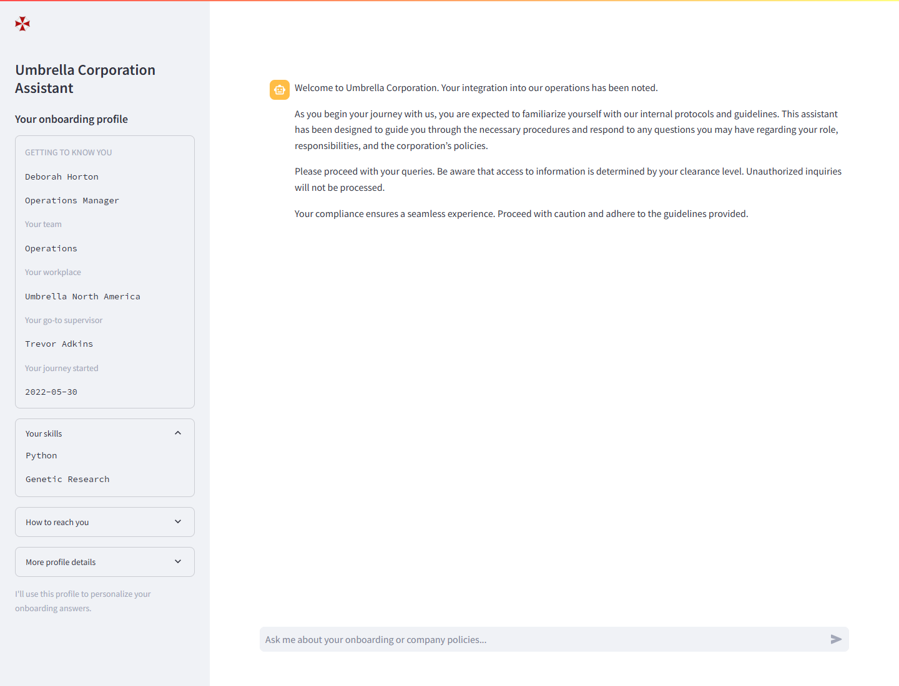
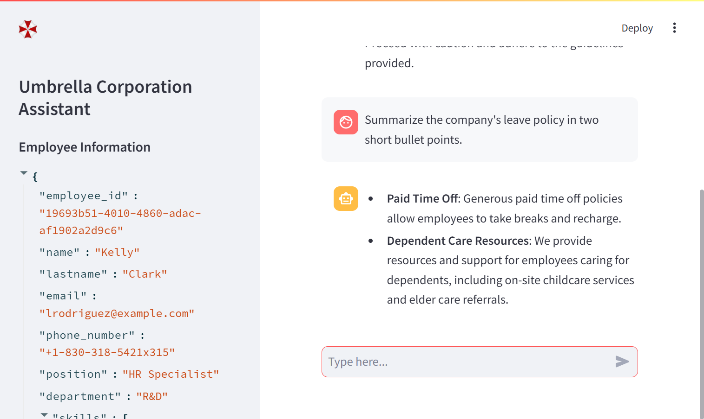
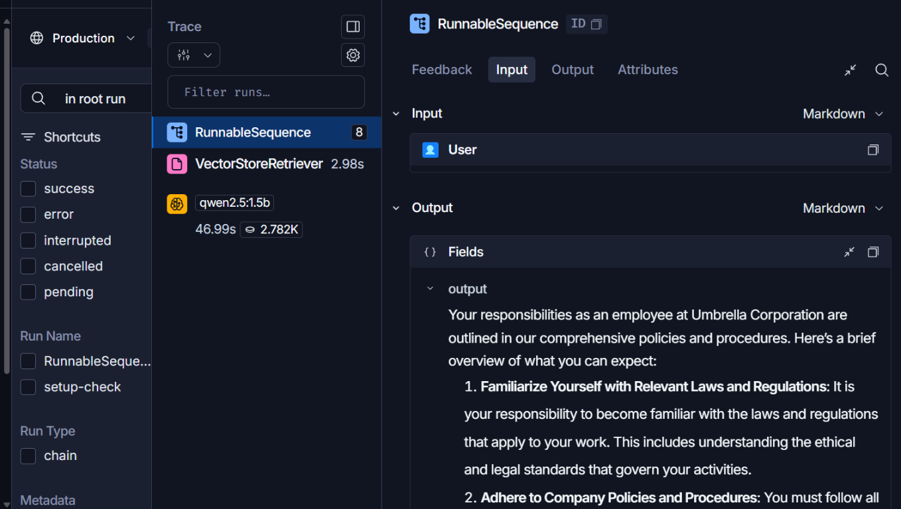

# Employee Onboarding Assistant - Local RAG Demo

A working Streamlit chatbot that answers employee onboarding questions using a
company policy PDF and a synthetic employee profile. The demo uses the fictional
Umbrella Corporation as its company setting.

Built with **Python, Streamlit, LangChain, Chroma, and Ollama**, with optional
**LangSmith tracing and observability**. Language model inference and embedding
generation run locally without a paid LLM API or LLM API keys. Cloud-hosted
LangSmith tracing requires a separate account, API key, and internet connection.

## What I built

- **Policy-aware chat:** Retrieves relevant passages from the included policy
  PDF using retrieval-augmented generation (RAG).
- **Personalized responses:** Includes a generated employee profile in the
  prompt, with details such as role, department, skills, and supervisor.
- **Employee sidebar:** Displays a labeled profile card instead of raw JSON,
  with expandable skills, contact information, and additional profile details.
- **Focused interface:** Hides Streamlit's running/stop/deploy toolbar while
  keeping the sidebar toggle available.
- **Streaming answers:** Shows the response as the local model generates it.
- **Conversation context:** Keeps chat history and the selected employee in
  Streamlit session state.
- **Persistent policy index:** Saves embeddings in a local Chroma database and
  reuses a nonempty index on subsequent starts.
- **Error feedback:** Displays connection, missing-model, indexing, and
  generation errors in the interface, with diagnostic logs in the terminal.
- **LangSmith observability:** Uses LangChain's environment-enabled tracing to
  inspect the RAG chain, retrieval and model calls, inputs/outputs, execution
  timing, and model-reported token usage.

## Screenshots

Captured from the running application with local Ollama models. All employee
details shown are synthetic demo data. The updated interface uses a labeled
profile card and expandable sections, with Streamlit's toolbar hidden.

### Welcome screen and employee profile



### Policy question and response



These screenshots show actual demo output, not verified HR advice. Responses
can vary and should be checked against the policy PDF.

### LangSmith RAG trace



This captured demo trace shows a `RunnableSequence`, its `VectorStoreRetriever`
call, and the `qwen2.5:1.5b` model call. The displayed timings and token
information describe one run, not a performance benchmark. The dashboard's
"Production" label does not mean this demo is a production-deployed HR system.

## How it works

```text
Policy PDF -> Load and split text -> Ollama embeddings -> Chroma on disk
                                                              |
Employee question -> Retrieve relevant policy passages --------+
        |
        v
Question + policy passages + employee profile + chat history
        |
        v
LangChain prompt -> Ollama chat model -> Streamlit streaming response
```

On startup, the app checks that Ollama can access both configured models. If
the Chroma collection is empty, it loads the PDF, splits it into 1,000-character
chunks with 200-character overlap, and embeds those chunks. Each question
retrieves policy context before the chat model generates an answer.

When LangSmith tracing is enabled, LangChain also sends trace data to LangSmith
for inspection. This does not move Ollama inference or the Chroma index to the
cloud.

## Prerequisites

- **Windows with 64-bit Python 3.11:** Recommended for the current pinned
  dependencies and Windows-style data paths. Python 3.12 can require a local
  C++ build for the pinned Chroma dependency.
- **[Ollama for Windows](https://ollama.com/download/windows)** installed and
  running.
- Internet access for the initial Python dependency and model downloads.
- Available disk space and RAM for the models and local vector database.
  Generation speed depends on your CPU/GPU and available memory.

The instructions below use **PowerShell**. Run project commands from the
directory containing `app.py` and `requirements.txt`, not from its parent.

## Setup and run

### 1. Create a Python environment and install dependencies

Open the project folder in a terminal, then run:

```powershell
py -3.11 -m venv .venv
.\.venv\Scripts\python.exe -m pip install --only-binary=chroma-hnswlib -r requirements.txt
```

These commands use the virtual environment directly, so activation and
PowerShell execution-policy changes are not required.

If using VS Code, run **Python: Select Interpreter** and choose
`.venv\Scripts\python.exe`.

### 2. Download the local models

Keep the Ollama desktop app running and execute:

```powershell
ollama pull qwen2.5:1.5b
ollama pull nomic-embed-text
ollama list
```

Confirm that both models appear in the list. The chat model generates answers;
the embedding model converts policy chunks and questions into vectors for
similarity search.

### 3. Configure Ollama (optional)

The app works with the following defaults. To override them, create a `.env`
file in the project root:

```dotenv
OLLAMA_BASE_URL=http://localhost:11434
OLLAMA_CHAT_MODEL=qwen2.5:1.5b
OLLAMA_EMBEDDING_MODEL=nomic-embed-text
```

| Variable | Purpose |
| --- | --- |
| `OLLAMA_BASE_URL` | Address of the running Ollama server. |
| `OLLAMA_CHAT_MODEL` | Installed chat model used to generate answers. |
| `OLLAMA_EMBEDDING_MODEL` | Installed embedding model used for indexing and retrieval. |

Values must not be blank. If you choose another model, download it with
`ollama pull <model-name>` first. Restart Streamlit after changing configuration.
Changing the embedding model also requires rebuilding the policy index.

No Azure, OpenAI, or Groq configuration is required. LangSmith is optional and
is configured separately below.

### 4. Configure LangSmith tracing (optional)

Create a [LangSmith](https://smith.langchain.com/) account and API key, then add
the following to your local `.env` file:

```dotenv
LANGSMITH_TRACING=true
LANGSMITH_API_KEY=replace-with-your-langsmith-api-key
LANGSMITH_ENDPOINT=https://api.smith.langchain.com
LANGSMITH_PROJECT=onboardiq-rag-assistant
```

| Variable | Purpose |
| --- | --- |
| `LANGSMITH_TRACING` | Enables LangChain tracing when set to `true`. |
| `LANGSMITH_API_KEY` | Authenticates trace uploads to LangSmith. Keep it secret. |
| `LANGSMITH_ENDPOINT` | LangSmith API endpoint; the example uses the US region. |
| `LANGSMITH_PROJECT` | Project name under which this app's traces appear. Use your existing project name if applicable. |

The app loads `.env` at startup, and LangChain's tracing integration records
chain runs without extra instrumentation in the application code. The installed
integration also supports the older `LANGCHAIN_TRACING_V2`, `LANGCHAIN_API_KEY`,
`LANGCHAIN_ENDPOINT`, and `LANGCHAIN_PROJECT` settings. Avoid conflicting values
if both naming schemes are present.

Use the endpoint for your account's region as described in the
[LangSmith tracing documentation](https://docs.langchain.com/langsmith/trace-with-langchain).
Restart Streamlit after changing these settings. Ask a policy question, then
open the configured project in LangSmith to inspect the chain, retrieved
documents, prompt/model inputs, generated output, timings, and any recorded
errors. Token information depends on what the model integration reports.

Tracing can upload questions, retrieved policy passages, employee information,
conversation history, and model responses. Use only synthetic/demo data here;
do not enable cloud tracing for confidential documents or real employee data
without appropriate authorization and data-handling controls. Keep `.env`
untracked and never publish API keys in screenshots or commits.

To run without trace uploads, set `LANGSMITH_TRACING=false`, remove any legacy
tracing-enable settings, and restart the app. LangSmith tracing is not required
for local policy Q&A and does not itself provide automated answer-quality
evaluation or production alerting.

### 5. Start the application

```powershell
.\.venv\Scripts\python.exe -m streamlit run app.py
```

Open the local URL printed by Streamlit, normally
**http://localhost:8501**. Wait for initialization, check the employee profile in
the sidebar, and enter a question in the chat input.

An empty policy index takes longer to initialize because the PDF must be
embedded. A saved, nonempty index is reused.

Stop the application with **Ctrl+C** in its terminal.

## Try it

Example questions:

- "What is the company's leave policy?"
- "What workplace safety rules should I know as a new employee?"
- "What security policies are relevant to my department?"
- "Who is my supervisor?"

Follow up with another question to see how the assistant uses conversation
history. Policy answers depend on what the included PDF actually contains and
on the local model's capabilities.

## Project structure

```text
client-onboarding-rag-demo/
|-- app.py                         # Configuration, model checks, indexing, startup
|-- assistant.py                   # LangChain retrieval and streaming chat pipeline
|-- gui.py                         # Streamlit sidebar, messages, and chat input
|-- prompts.py                     # System prompt and welcome message
|-- requirements.txt               # Pinned Python dependencies
|-- data/
|   |-- employees.py               # Faker-based synthetic employee generator
|   |-- umbrella_corp_policies.pdf  # Policy knowledge source
|   `-- vectorstore_ollama/         # Persisted Chroma index
`-- tests/
    `-- test_ollama.py              # Mocked offline regression tests
```

## Updating the knowledge base

The app indexes only when the Chroma collection is empty; it does not detect
PDF edits or embedding-model changes automatically.

To replace the policies or change the embedding model:

1. Stop Streamlit.
2. Update `data\umbrella_corp_policies.pdf` or the embedding-model setting.
3. If changing models, download the new embedding model.
4. Move or rename only `data\vectorstore_ollama` to keep it as a backup.
5. Restart the app. It creates a new index using the current PDF and model.

Changing only the chat model does not require rebuilding the index.

## Tests

With the project dependencies installed, run:

```powershell
.\.venv\Scripts\python.exe -m unittest discover -s tests -p test_ollama.py
```

The tests use mocks and a fake chat model, so they do not require a running
Ollama server or model downloads. They cover response streaming, connection
and missing-model errors, index reuse, and GUI chat-history updates. They do
not measure real-model answer quality.

## Troubleshooting

| Problem | What to do |
| --- | --- |
| Cannot connect to Ollama | Start the Ollama desktop app, or run `ollama serve` in another terminal if the server is not already running. Check `OLLAMA_BASE_URL`. |
| Model is not installed | Run `ollama pull` with the exact configured model name, then restart the app. |
| Connection refused at a temporary `/tokenize` port | Quit and reopen Ollama, then restart Streamlit. Keep the base URL at `http://localhost:11434`; do not use the temporary port or delete the index for this error. |
| Policy PDF cannot be found | Run Streamlit from the project root and confirm `data\umbrella_corp_policies.pdf` exists. |
| Answers still reflect old policies | Rebuild the index using the steps above after changing the PDF or embedding model. |
| Installation tries to compile `chroma-hnswlib` | Use 64-bit Python 3.11 and the installation command above. |
| PyArrow reports a NumPy version conflict | Stop Streamlit and rerun the requirements installation. Keep the pinned PyArrow 17.0.0; do not upgrade NumPy to 2 with these LangChain pins. |
| Responses are slow or inaccurate | Check available memory and Ollama status. The default 1.5B chat model prioritizes lower resource use over capability; a larger compatible chat model needs more resources. |
| LangSmith traces do not appear | Check that tracing is enabled, the API key and regional endpoint are correct, and the selected project matches `LANGSMITH_PROJECT`. Check internet access and terminal upload errors, then restart Streamlit. Never paste the API key into logs or issue reports. |

Application diagnostics appear in the terminal running Streamlit. With
optional LangSmith tracing enabled, RAG execution traces are also available in
the configured LangSmith project.

## Demo scope and limitations

- Employee details are synthetic, not connected to an HR system. Generation is
  cached for one hour, and the selected profile stays in session state.
  The shared generation cache is not per-user identity isolation.
- Chat history is session-only; there is no durable conversation database.
- This is a demo, not a production HR or policy-advice system. Model responses
  can be incomplete or incorrect and should be checked against the policy PDF.
- The fictional clearance and escalation language comes from the prompt.
  There is no authentication, enforced access control, or real escalation
  workflow.
- Retrieved passages inform answers, but the UI does not provide a dedicated
  source-citation panel.
- With the default configuration, model requests go to local Ollama. Initial
  downloads need internet access, and the sidebar logo loads from Wikimedia.
  Configuring a remote Ollama URL sends model requests to that server.
- LangSmith tracing is optional cloud-hosted observability. When enabled, trace
  content is sent to the configured LangSmith endpoint even though inference
  remains local. Traces do not establish answer accuracy or production readiness.
